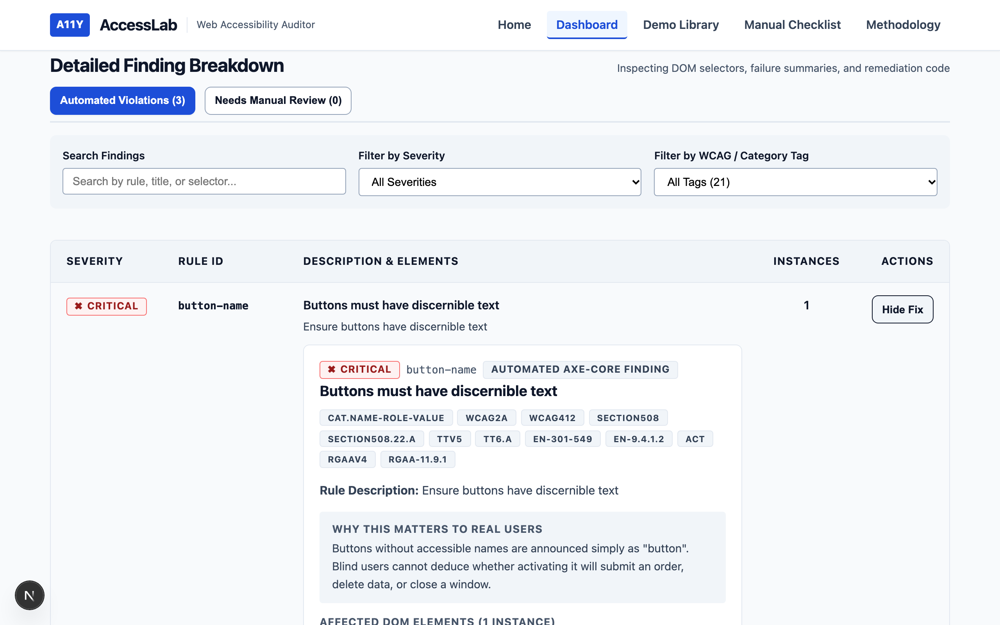
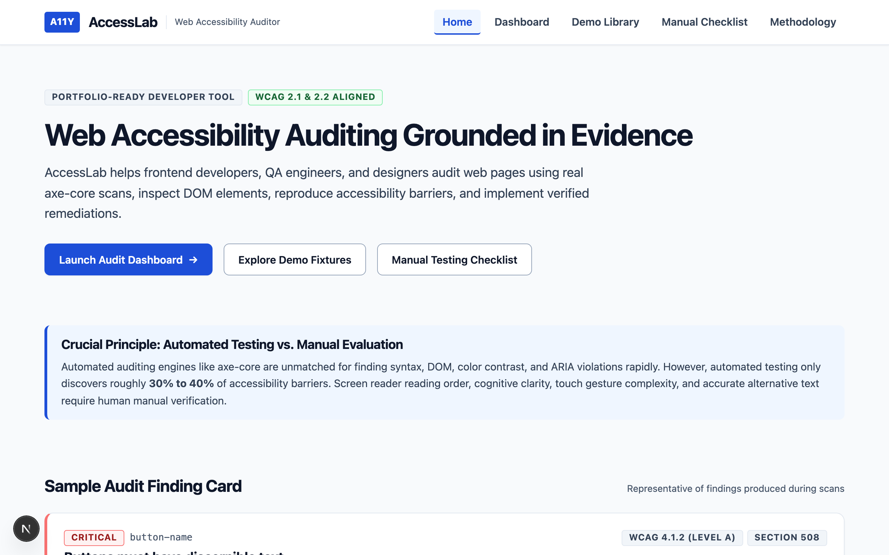
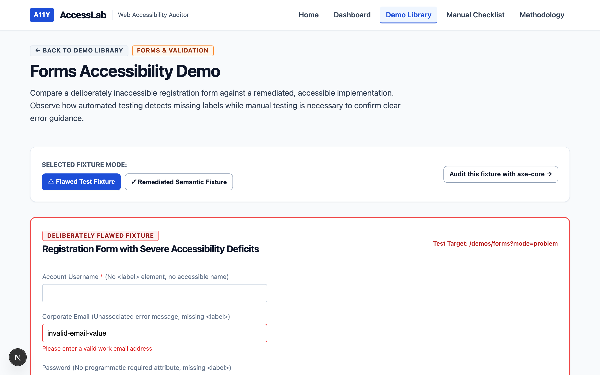
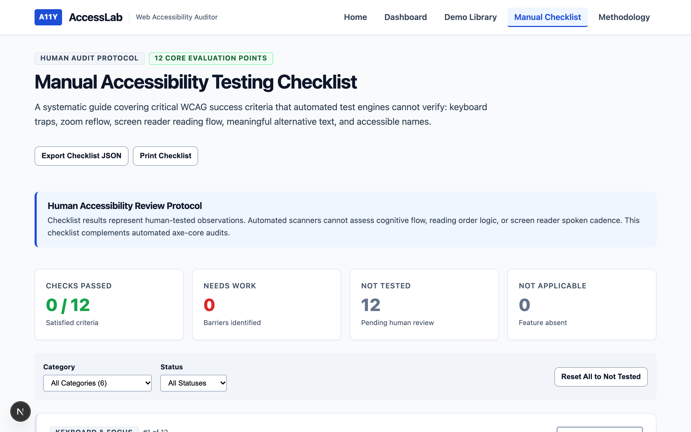

# AccessLab — Web Accessibility Auditor

> **An evidence-grounded web accessibility auditing platform and developer learning suite aligned with WCAG 2.1/2.2 and axe-core.**

---

## 1. Project Overview & Links

AccessLab is a portfolio-ready web accessibility developer tool designed to bridge the gap between automated linting and real-world human accessibility. It executes genuine `axe-core` audits via Playwright against controlled test fixtures, dissects DOM elements, reproduces barriers, and provides verified remediation guidance alongside an interactive 12-point manual review checklist.

- **Repository**: [https://github.com/kartikbhadane15/accesslab-web-accessibility-auditor](https://github.com/kartikbhadane15/accesslab-web-accessibility-auditor)
- **Primary Standards**: WCAG 2.1 & 2.2 Conformance Levels A & AA, Section 508, WAI-ARIA 1.2
- **Engine**: axe-core v4.14 running in Playwright Chromium

---

## Visual Interface Preview

| Audit Dashboard & Finding Inspection | Landing Page Overview |
|:---:|:---:|
|  |  |

| Interactive Fixture Comparison | 12-Point Manual Testing Checklist |
|:---:|:---:|
|  |  |

---

## 2. Problem Statement

Many teams treat web accessibility as an afterthought or rely on superficial automated "score badges" and third-party script overlay widgets. In reality:
- Automated scanners detect only **30% to 40%** of accessibility barriers.
- A score of "100" from an automated tool does not guarantee that a blind, low-vision, or motor-impaired user can navigate a site.
- Developers often struggle to understand *why* a reported violation matters to a human or *how* to write the semantic HTML that resolves it.

AccessLab was engineered to solve this through evidence-based reporting: showing real axe-core failures on intentionally flawed fixtures, providing immediate comparisons with remediated accessible code, and enforcing manual testing protocols.

---

## 3. Core Features

### 🔍 Real Automated axe-core Scanning
- Executes headless Chromium browser scans against local test routes.
- Captures `violations`, `incomplete` (needs manual review), `passes`, and `inapplicable` rules.
- Retains authentic rule IDs, impact levels, selectors, and failure summaries without artificial score inflation.

### 🧪 Dual Test Fixture Library
- **Forms Demo (`/demos/forms`)**: Missing labels, unassociated error messages, color-only required fields, and non-semantic `<div>` buttons vs. accessible inputs with `htmlFor`, `aria-describedby`, `aria-invalid`, and native buttons.
- **Navigation Demo (`/demos/navigation`)**: Suppressed focus outlines (`outline: none`), pseudo-links without `href`, and hover-only menus vs. high-contrast `:focus-visible` rings, semantic links, and ARIA disclosure dropdowns.
- **Content Demo (`/demos/content`)**: Missing/uninformative `alt` attributes, skipped heading ranks (H1 to H4), and low text contrast vs. descriptive alt text, logical heading trees, and 15.3:1 contrast.

### 📋 12-Point Manual Testing Checklist (`/checklist`)
- Checkable, persistent audit framework covering criteria that automated engines cannot evaluate: keyboard traps, focus visibility, logical focus order, 200% zoom and 400% reflow, dynamic contrast, and screen reader announcements.
- Status tracking (`Pass`, `Needs Work`, `Not Tested`, `Not Applicable`) with notes and export capability.

### 📊 Comprehensive Report Exporting
- Export audit records as structured **JSON** and **CSV**.
- Client-side sanitization preventing CSV formula injection (CWE-1236) and HTML injection.
- Print-optimized CSS for generating clean PDF audit summaries.

### 🛡️ SSRF Security Protection
- AccessLab strictly constrains automated scans to an allowlist of approved local fixtures (`lib/scan/scanTypes.js`), mitigating Server-Side Request Forgery (SSRF) and malicious redirect risks.

---

## 4. Architecture & Tech Stack

```text
accesslab/
├── app/
│   ├── layout.js          # Root HTML layout with skip-to-content & landmarks
│   ├── page.js            # Landing page with hero & preview finding
│   ├── dashboard/page.js  # Audit Dashboard with scan launcher & findings table
│   ├── checklist/page.js  # 12-Point Manual Testing Checklist
│   ├── methodology/page.js# WCAG standards & POUR methodology
│   ├── demos/             # Interactive test fixture catalog
│   │   ├── forms/page.js
│   │   ├── navigation/page.js
│   │   └── content/page.js
│   ├── api/scan/route.js  # Secure scan API endpoint
│   └── globals.css        # Accessible design system & tokens
├── components/            # Reusable UI components
├── lib/
│   ├── scan/              # Playwright & axe-core scan engine
│   ├── report/            # JSON/CSV export utilities & sanitization
│   └── accessibility/     # 12-point checklist definitions
├── tests/
│   └── accessibility/     # Automated Playwright test suites (12 tests)
└── docs/                  # Detailed engineering documentation
```

- **Framework**: Next.js (App Router, JavaScript)
- **UI & Styling**: React with Semantic HTML and CSS Custom Properties
- **Accessibility Engine**: `axe-core` & `@axe-core/playwright`
- **Automation & Testing**: Playwright Test Suite
- **Standards**: WCAG 2.1 & 2.2 (POUR Principles)

---

## 5. Local Setup & Commands

### Prerequisites
- Node.js 18.x or later (tested on Node v25.6.0)
- npm 9.x or later

### Installation
```bash
# 1. Clone repository
git clone https://github.com/kartikbhadane15/accesslab-web-accessibility-auditor.git
cd accesslab-web-accessibility-auditor

# 2. Install dependencies
npm install

# 3. Install Playwright Chromium browser
npx playwright install chromium
```

### Running Locally
```bash
# Start Next.js development server
npm run dev

# Open in browser
open http://localhost:3000
```

### Running Tests
```bash
# Run all automated Playwright accessibility and security tests
npm test

# Run tests in UI mode
npx playwright test --ui
```

---

## 6. How the Scanner Works

1. **User Action**: The auditor selects a fixture in the Dashboard or requests a scan via `POST /api/scan`.
2. **Allowlist Validation**: `runDemoScan.js` verifies that the requested route matches an authorized entry in `ALLOWED_SCAN_PATHS`.
3. **Headless Execution**: A headless Chromium instance is spawned via Playwright and navigates to the target fixture.
4. **axe-core Injection**: The client-side `axe-core` bundle is injected into the document context and executed with standard WCAG 2.1/2.2 AA tags (`wcag2a`, `wcag2aa`, `wcag21a`, `wcag21aa`, `wcag22aa`, `best-practice`).
5. **Normalization**: Raw engine results are mapped into AccessLab's structured audit shape, separating definite violations from items requiring review.
6. **Rendering**: The UI displays real finding cards with safely escaped HTML, selector targets, and verified remediation guidance.

---

## 7. Sample Finding & Remediation

### Finding: Form Control Missing Accessible Label
- **Rule ID**: `label` (WCAG 4.1.2 Level A, WCAG 3.3.2 Level A)
- **Severity**: Critical
- **Failure**: `<input id="flawed-username-input" type="text">` has no programmatic `<label>`, `aria-label`, or `aria-labelledby`.
- **Human Impact**: Screen reader users hear only "edit text blank" without context on what information to enter.
- **Remediation**:
  ```html
  <!-- Remediated Implementation -->
  <label for="acc-username">
    Account Username <span aria-hidden="true">*</span>
    <span class="sr-only">(required)</span>
  </label>
  <input
    id="acc-username"
    name="username"
    type="text"
    required
    aria-required="true"
    autocomplete="username"
  />
  ```

---

## 8. Automated vs. Manual Testing

| Capability | Automated (axe-core) | Manual (Human Review) |
|---|---|---|
| Detect missing `<label>` or `alt` attributes | ✅ 100% Reliable | Redundant |
| Mathematical contrast on solid backgrounds | ✅ 100% Reliable | Redundant |
| Evaluate alt text accuracy / descriptive quality | ❌ Impossible | ✅ Essential |
| Verify logical keyboard tab & reading order | ❌ Impossible | ✅ Essential |
| Confirm focus outlines are not obscured by sticky navs | ❌ Impossible | ✅ Essential |
| Evaluate error message helpfulness & clarity | ❌ Impossible | ✅ Essential |
| Screen reader reading flow & acoustic cadence | ❌ Impossible | ✅ Essential |

---

## 9. Accessibility Choices in AccessLab's Interface

AccessLab practices what it teaches:
- **Landmark Structure**: Built with semantic `<header role="banner">`, `<nav aria-label="Main Navigation">`, `<main id="main-content">`, and `<footer role="contentinfo">`.
- **Skip to Content Link**: First focusable item on every page, visually revealed on focus, transferring programmatic focus to `#main-content`.
- **High-Contrast Design System**: Body text achieves 15.3:1 contrast against white backgrounds (exceeding WCAG AAA 7:1).
- **Unambiguous Focus Indicator**: 3px solid high-contrast outline with 3px offset (`:focus-visible`) across all interactive controls.
- **Multimodal State**: Badges combine color, text labels, and geometric icons.
- **Reduced Motion**: Respects `prefers-reduced-motion: reduce` by suppressing all animations and transitions.
- **Screen Reader Tested**: Programmatic status announcements using `aria-live="polite"` and `role="status"`.

---

## 10. Known Limitations & Responsible Use

- **No Arbitrary URL Scanning**: To protect against SSRF, credential leakage, and malicious redirect attacks, the MVP scanner is restricted to local demo fixtures.
- **No Certification Claim**: AccessLab is an educational developer-support tool. It never claims that any website is "100% compliant" or "certified accessible."
- **Dual-Track Necessity**: Automated test results must always be combined with human manual testing using assistive technologies.

---

## 11. Official References & Standards

- [W3C Web Accessibility Initiative (WAI)](https://www.w3.org/WAI/)
- [W3C WCAG 2.2 Recommendation](https://www.w3.org/TR/WCAG22/)
- [WAI-ARIA Authoring Practices Guide (APG)](https://www.w3.org/WAI/ARIA/apg/)
- [Deque axe-core Documentation](https://dequeuniversity.com/rules/axe/)
- [Playwright Testing Framework](https://playwright.dev/)
